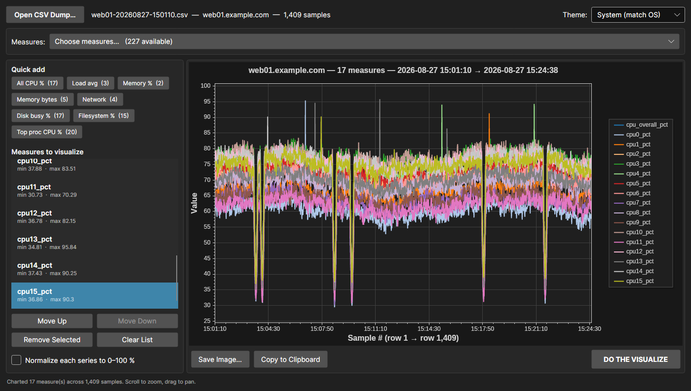
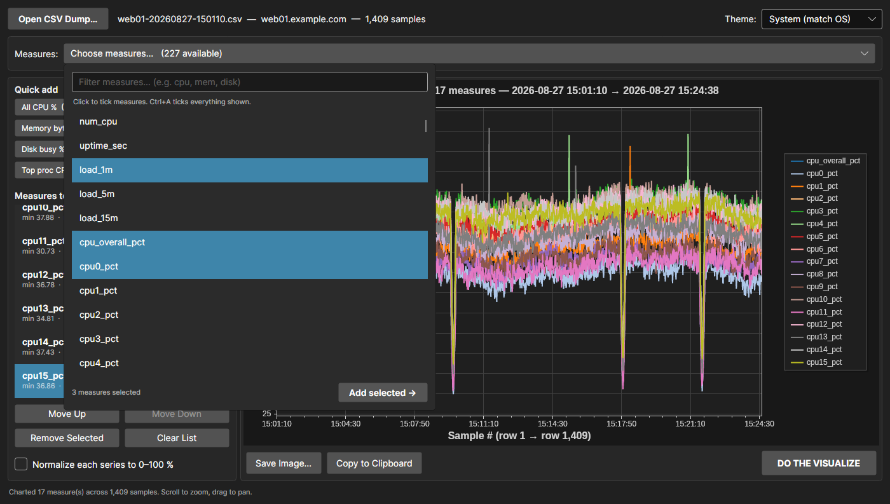
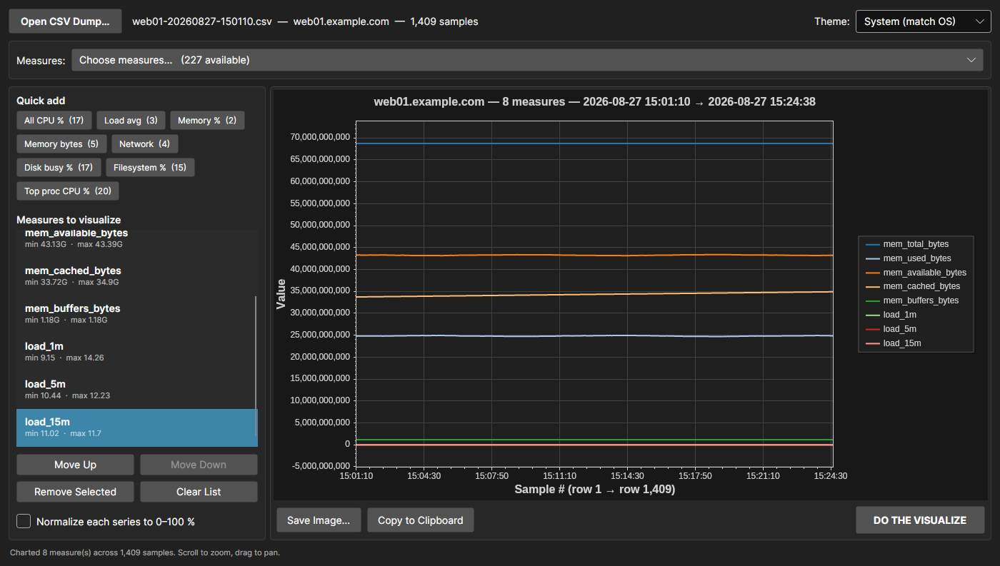
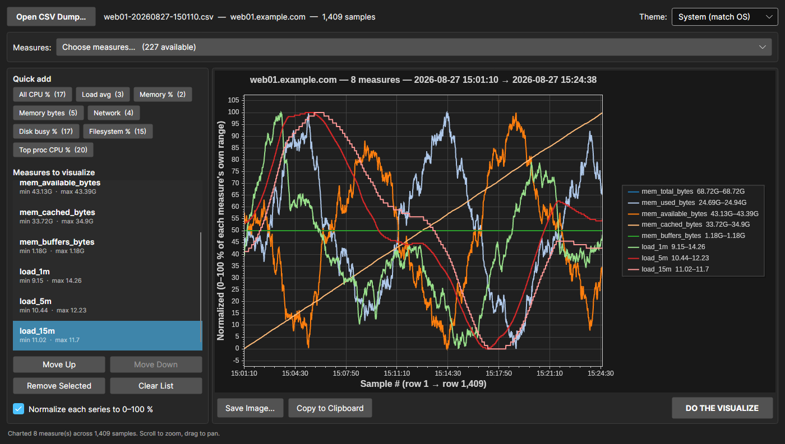
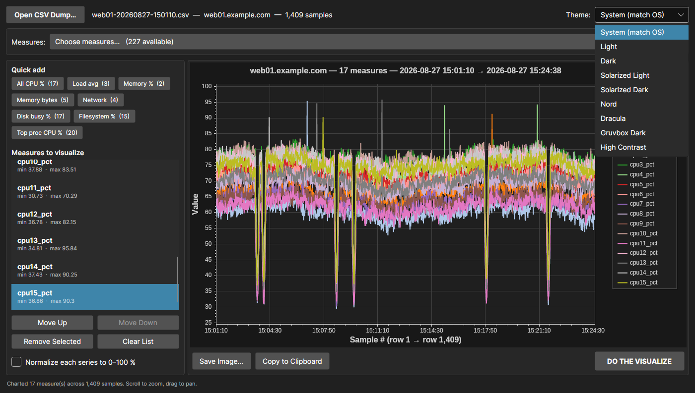
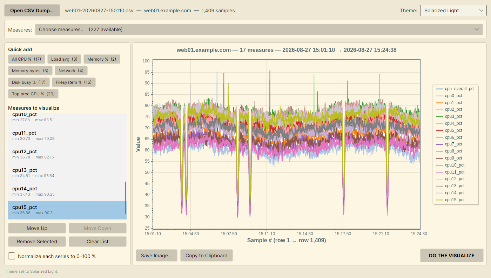
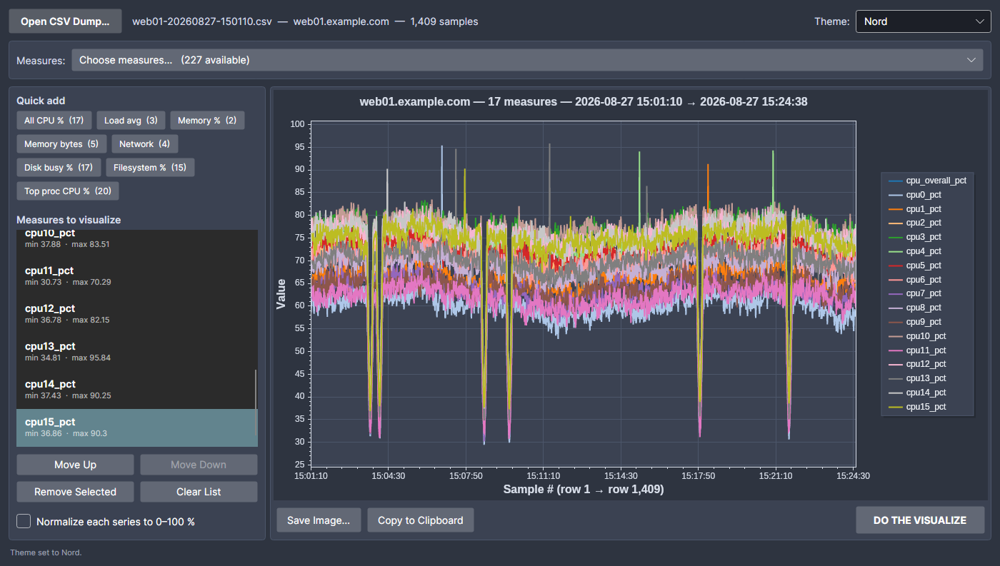

# SSHRTM Log Visualizer

A cross-platform desktop app that turns an SSHRTM CSV metric dump into a multi-series line
chart. Point it at a dump, pick the measures you care about, and plot them against the sample
timeline.

Built with [Avalonia](https://avaloniaui.net/) 12 on .NET 9, charting with
[ScottPlot](https://scottplot.net/) 5.



---

## What it's for

SSHRTM writes a wide CSV: one row per sample, one column per metric, a trailing timestamp.
A real dump is ~260 columns across a few thousand rows — far too wide to read in a spreadsheet
and awkward to chart ad hoc. This app reads that shape directly and lets you pull any
combination of measures onto one time axis.

Everything it knows about the format is derived from the file itself, so it works on a dump
from any host without configuration.

## Requirements

- .NET 9 SDK (or newer) to build; the built app needs only the .NET 9 runtime
- Windows, macOS or Linux

## Build and run

```bash
dotnet build SSHRtmLogVisualizer.sln
dotnet run --project SSHRtmLogVisualizer
```

Optionally pass a dump path to open it at startup — this also lets you drop a `.csv` onto the
built executable:

```bash
dotnet run --project SSHRtmLogVisualizer -- web01-20260827-150110.csv
```

## Publishing a single executable

Publish profiles produce **one self-contained file** — no .NET runtime needed on the target
machine, no support DLLs to ship alongside it.

```bash
dotnet publish SSHRtmLogVisualizer -c Release -p:PublishProfile=win-x64
dotnet publish SSHRtmLogVisualizer -c Release -p:PublishProfile=linux-x64
```

Output lands in `publish/<rid>/` and is a single ~47 MB executable. Copy it anywhere and run
it; that is the whole deployment.

| Profile | Output |
| --- | --- |
| `win-x64` | `publish/win-x64/SSHRtmLogVisualizer.exe` |
| `linux-x64` | `publish/linux-x64/SSHRtmLogVisualizer` |

For another target, pass the RID directly:

```bash
dotnet publish SSHRtmLogVisualizer -c Release -r osx-arm64 --self-contained \
    -p:PublishSingleFile=true
```

Notes on the size and the settings behind it:

- The ~47 MB is mostly the bundled .NET runtime plus SkiaSharp's native rendering library.
  Compression is on, so the file is roughly a third of its uncompressed footprint.
- Native libraries are bundled with `IncludeNativeLibrariesForSelfExtract`, which means the
  first launch extracts them to a temp directory — expect a couple of seconds on first run and
  a fast start after that.
- Trimming is deliberately **off**. Avalonia resolves controls and XAML through reflection, and
  a trimmed build risks failing at runtime in ways a successful build won't reveal. Turn it on
  in the profile only if you are willing to retest the whole UI.
- If every target machine already has the .NET 9 runtime, a framework-dependent single file is
  far smaller — add `--no-self-contained` to the command above.

---

## Using it

### 1. Open a dump

**Open CSV Dump…** picks a file. The header bar then shows the file name, the host it came
from, and the sample count; the status bar reports how many measures are chartable.

### 2. Choose measures

**Choose measures…** opens a multi-select picker over every numeric column in the dump.
Click entries to tick them — no Ctrl needed — Shift+click for a run, Ctrl+A for everything
currently shown. The filter box at the top narrows a long list; a typical dump offers well
over two hundred measures.



**Add selected →** appends every ticked measure to the visualize list at once, skipping any
already there. The picker stays open so you can filter again and add another batch. Changing
the filter clears the current ticks, so a tick never refers to a measure you can no longer see.

### 3. Or use a quick-add preset

The **Quick add** buttons pull in a whole related group in one click. Each button shows how
many measures it will add, and presets are built from the dump you opened — one that matches
nothing simply doesn't appear.

| Preset | Matches |
| --- | --- |
| All CPU % | `cpu_overall_pct` and every `cpuN_pct` |
| Load avg | `load_1m`, `load_5m`, `load_15m` |
| Memory % | `mem_used_pct`, `swap_used_pct` |
| Memory bytes | every `mem_*_bytes` |
| Network | per-interface rx/tx bit rates |
| Disk busy % | per-device `busy_pct` |
| Filesystem % | per-mount `used_pct` |
| Top proc CPU % | `procN_cpu_pct` for the top processes |

Presets **append** rather than replace, so you can stack Memory % on top of All CPU %.

### 4. Edit the list

**Move Up** / **Move Down** reorder (which sets the series colour order), **Remove Selected**
drops one, and **Clear List** empties it. Whenever the list becomes empty the chart is cleared
too, so what's on screen always matches what's in the list.

### 5. Visualize

**DO THE VISUALIZE** draws the chart. The first data row sits at the left edge, the last at
the right, and both axes auto-scale to the data. X ticks are labelled with the timestamp of
the row they fall on.

On the chart: scroll to zoom, drag to pan, right-click for ScottPlot's own menu.

---

## Mixed units and the normalize option

A dump mixes units freely. Plot `mem_*_bytes` (tens of billions) next to load averages
(around 12) on a shared axis and the load lines collapse onto zero:



Tick **Normalize each series to 0–100 %** and every series is rescaled onto its own min–max
range, so the shapes become comparable. The legend then reports the real range each series was
squashed from:



Leave it off when your measures already share units — all the CPU percentages, say.

---

## Themes

The theme dropdown sits in the top-right corner. It defaults to **System (match OS)**, which
follows the operating system's light/dark setting and re-resolves live if that flips.



Selecting a theme repaints the window chrome, the control accent, and the chart together.

| Solarized Light | Nord |
| --- | --- |
|  |  |

The full list: System, Light, Dark, Solarized Light, Solarized Dark, Nord, Dracula,
Gruvbox Dark, High Contrast.

---

## Exporting the chart

- **Save Image…** writes the chart to a PNG, JPEG or BMP through a save dialog. The file name
  is suggested from the dump's own name, and the correct extension is appended if the dialog
  doesn't add one.
- **Copy to Clipboard** puts the chart on the clipboard as a PNG, ready to paste into a ticket
  or an email.

Both export at the on-screen size (with a 1000 × 560 floor), so the image matches what you see.

---

## How a dump is read

Row 1 holds the measure names. The **last** column is the sample timestamp — it is never
offered as a measure, and is used instead to label the X axis. `yyyyMMdd-HHmmss` is the
expected layout, with several other common forms accepted as a fallback.

Columns whose samples are text rather than numbers cannot be plotted, so they are left out of
the picker: `hostname`, the `fs_*_type` filesystem types, the `procN_command` process names.
The status bar reports how many were skipped. Blank or `n/a` samples become gaps in the line
rather than zeroes.

Values are parsed with the invariant culture — a dot decimal separator, matching what SSHRTM
writes — so the app reads a dump identically regardless of the machine's regional settings.
The CSV parser handles quoted fields, including embedded commas, quotes and newlines.

The dump is opened with `FileShare.ReadWrite`, so you can chart a file that SSHRTM is still
appending to.

---

## Project layout

| Path | Purpose |
| --- | --- |
| `Models/MetricColumn.cs` | One numeric measure: name, per-row values, min/max |
| `Models/RtmLogFile.cs` | A parsed dump: timestamps plus chartable measures |
| `Models/MetricPreset.cs` | A quick-add group resolved against the loaded dump |
| `Models/AppTheme.cs` | Theme definition — window palette and chart palette |
| `Services/RtmCsvReader.cs` | CSV parsing, timestamp parsing, numeric-column detection |
| `Services/ChartRenderer.cs` | Builds the ScottPlot line chart |
| `Services/ChartExporter.cs` | Save-to-file and copy-to-clipboard |
| `Services/ThemeManager.cs` | Theme catalogue and application |
| `ViewModels/MainWindowViewModel.cs` | Picker state, visualize list, edit commands |
| `MainWindow.axaml(.cs)` | Window layout, dialogs, chart hosting |
| `Properties/PublishProfiles/` | Single-file publish profiles per runtime |

## Dependencies

- Avalonia 12.1.1 (`Avalonia.Desktop`, `Avalonia.Themes.Fluent`, `Avalonia.Fonts.Inter`)
- ScottPlot.Avalonia 5.1.59 — charting
- CommunityToolkit.Mvvm 8.4.2 — observable properties and commands

## Notes and limits

- Every series shares one Y axis; there is no secondary axis. Normalize is the answer for
  mixed magnitudes.
- The X axis is the row index, not elapsed time. Rows are evenly spaced even if the sampling
  interval varies — the tick labels still show each row's real timestamp.
- Series colours cycle through a 20-colour palette, so charting more than 20 measures at once
  will repeat colours.
